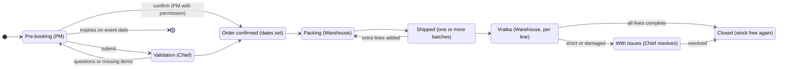

# HW Catalogue & Event Booking System — Concept

Nov 2, 2026 · @David — merged with the QUIX EVENT AV-system spec on Nov 16, 2026

## Purpose and scope

An internal web app that turns a project manager's rough request into a complete, packable, returnable list of hardware for an event. The catalogue and availability tracking exist to serve that flow.

The system has three jobs:

1. **Catalogue** every HW item with photos, stock count, storage location, rental price, the flight cases it travels in, and its connections to other items.
2. **Book** HW for events through a pre-booking → order → shipping → vratka chain, with every step owned by one role.
3. **Show availability** on a calendar: when each item is free, and if not, which order holds it.

The most valuable feature is the **connections engine**: the chief lists capital items (a light), and the system adds everything that must travel with them (power cable, control desk). The warehouse employee packs a complete list without needing to know what belongs to what.

**Merge principle.** This concept is the core. The colleague's spec ("Interní systém pro správu AV techniky") was merged in where it adds something we need: flight cases as records, a firmer conflict process, light service cases, basic external rentals, client records, partial shipments and (later) QR scanning and spot stock checks. What we did not adopt is listed under Decisions.

Out of scope: invoicing, accounting, full CRM, crew/technician scheduling, shifts and payroll, transport route planning. Serial numbers for every piece are explicitly not a goal.

## Roles and permissions

Each state change belongs to one role, so there is never doubt about who has the ball. Roles are **presets of permissions**, not hard limits: an admin can switch individual permissions on or off per user.

| Role | Main job | Can do | Cannot do (by default) |
| --- | --- | --- | --- |
| Project manager (PM) | Asks for HW for an event | Browse catalogue and calendar; create and edit own pre-bookings; add client and purpose message; comment; see status of own orders | Edit catalogue; confirm orders (unless granted); change stock |
| Chief of technical dept (Chief) | Validates and turns requests into orders | Everything a PM can; edit any pre-booking; mark missing items; override conflicts; create orders and set booking dates; manage catalogue, cases and connections; manage service cases; manage users | Confirm packing or return in the warehouse's name |
| Warehouse employee (Sklad) | Packs, ships and receives HW | See orders assigned to the warehouse; tick packing list; ship in batches; run vratka; report damage or loss; open service cases; update item and case location | Create orders; change connections or prices |
| Admin (optional, can be the Chief) | System setup | Users, permissions, storage locations, categories | — |

**Permission flags** (per user, on top of the role preset):

- `can_confirm_own_orders` — a trusted PM turns their own pre-booking into an order without the Chief. Their confirmation runs through exactly the same conflict checks; an override still needs a written reason and still creates a tracked conflict the Chief sees.
- `can_edit_catalogue` — e.g. a senior warehouse employee helps with catalogue setup.
- `can_manage_service` — e.g. a warehouse employee who looks after repairs.

Permissions are enforced in the database (Postgres row-level security and server functions), not only in the UI. Every important change records user and time.

## Booking lifecycle

One booking record moves through these states. Confirmation reserves stock; only a fully confirmed vratka releases it.

1. **Pre-booking** — PM lists what they think they need, with event name, client, dates and a purpose message ("Firemní večírek, 200 lidí, venkovní stage"). It shows its age and expires on the event date if it is not turned into an order. Conflicts show immediately (see Conflicts).
2. **Validation** — Chief reviews, edits quantities, marks lines *Missing*, *Substituted* or *External rental*, and can send it back to the PM with questions. Skipped for PMs with `can_confirm_own_orders`.
3. **Order confirmed** — capital items are complete; required connections have expanded automatically; booked-from / booked-until are set. Stock is now held.
4. **Packing** — Warehouse ticks each line (whole cases or loose items) on a flat list grouped by storage location.
5. **Shipped** — Warehouse confirms what left the house. Shipping can happen in several **batches** (van 1 today, van 2 tomorrow); each batch records what went, when and who confirmed it. Lines added after shipping go back to packing as a new batch, and the warehouse gets a high-priority notification. Edits after shipping are logged and flagged.
6. **Vratka** — Warehouse confirms every shipped line back (see Vratka).
7. **With issues** — Something is short or damaged; Chief resolves it.
8. **Closed** — All stock is free again and the record is read-only.

## HW catalogue

Every catalogue entry is an item *type* with a stock count (e.g. "Robe LEDBeam 150", 12 pcs), not one record per physical piece. Optional serial numbers may be added later for a few expensive pieces, but nothing in the system depends on them.

| Field | Type | Example | Notes |
| --- | --- | --- | --- |
| Name | text | Robe LEDBeam 150 | Searchable |
| Manufacturer / model | text | Robe / LEDBeam 150 | Searchable; from colleague's spec |
| Type / category | enum | Light → Moving head | Two levels, admin-editable; drives filters and icons |
| Pieces per warehouse | number | 12 | Split Brod / Karlák (e.g. 8 + 4); total is the sum |
| Out of service | derived | 1 | Sum of open service cases; subtracted from availability |
| Storage location | reference | Sklad A / Regál 3 / Police 2 | Hierarchy: warehouse (Brod / Karlák) → section/rack → shelf; one home location per warehouse |
| Rental price | CZK per day | 450 Kč | Indicative price to quote the client; visible to all roles; orders show a running total |
| Photos | image list | 1–5 photos | First photo is the thumbnail |
| Connections | list | → Clamp ×1 (required) | See Connections engine |
| Cases | reference | AX9 case (8 pcs) | Which case types this item is packed in; see Flight cases |
| Weight / dimensions | number | 6.5 kg | Optional; useful for transport planning |
| Returnable | yes/no | yes | No for consumables |
| Notes | text | Needs DMX 5-pin | Free text |

**Consumables vs. returnables.** Each item gets a flag *Returnable* (default yes). Gaffer tape, batteries and similar consumables are not expected back in vratka; their stock is reduced on shipping instead.

**Later:** structured technical specs per category (power, DMX channels, IP rating, pixel pitch…), attachments (datasheets, manuals, certificates) and automatic totals per order (power, weight, DMX channels).

## Flight cases

A flight case is the physical box gear travels in (e.g. a case of 8 Astera AX9 tubes with chargers). Cases are real records so the warehouse can book, pack and return whole cases, and so a case missing something is visible.

- **Case type** — a template with a **standard contents list** in counts, not serials: "AX9 case = 8× Astera AX9, 8× charger, 1× power supply". Packing photo optional.
- **Case** — one physical box of a type, with a case number ("AX9-02"), a home location and its **actual contents** (counts). A case whose actual contents differ from the standard is flagged **incomplete** and shows exactly what is missing.
- **Stock stays with the items.** Pieces inside cases are still counted in the item's stock. A case is a container, not extra stock.

**Booking and packing**

- An order line can be a **case type** ("AX9 case ×2") or **loose items** ("Astera AX9 ×3"). A case line reserves the case and its contents; a loose-item line reserves item counts only.
- The warehouse picks the specific case numbers when packing. The packing list shows a case as one line with its contents underneath.
- PMs (and the Chief) can book **either whole cases or single pieces**, or mix both on one order.
- If loose pieces are taken out of a case, the packer records which case they came from, and that case becomes incomplete until it is refilled.
- **Cases always go back to full.** In vratka, pieces that came out of a case are suggested back into *that* case (prefilled destination). If they go elsewhere, are missing, or go to service, the case stays incomplete and a **"Doplnit case"** task appears on the warehouse dashboard. Refilling means moving pieces from loose stock into the case (or confirming they were put back). Reminders: the warehouse after 2 days, escalation to the Chief after 7 days.
- Availability of a case type = complete cases not held by another order in the period. The order editor warns if loose-item bookings would leave too few complete cases for orders that booked whole cases.

**Returns** — a returned case is confirmed against its standard contents (see Vratka). Missing contents keep the case flagged incomplete and create a pending issue.

**Later:** a QR label per case and per shelf; scanning opens the case card (contents, completeness, current order, location).

## Connections engine

A connection is a link from one item to another with a kind and a quantity rule. There are three kinds, each shown in its own clearly separate place in the UI. They are configured in the catalogue editor, never hard-coded per model.

| Kind | UI label | Behaviour | Example |
| --- | --- | --- | --- |
| Required | **Co k tomu nutně potřebuješ** | Added automatically to the order as soon as the parent is added. Shown nested under the parent, marked "auto". Can only be removed by the Chief, with a reason. Use for things the item truly cannot work without. | LEDBeam → Clamp ×1, Safety rope ×1 |
| Check | **Máš aspoň jeden z těchto?** | Not added automatically. At confirmation the system checks that at least one of the listed items is somewhere on the order; if not, it shows a warning with one-click add. The Chief can dismiss it. Never blocks. Use for cables, adapters and other bulk accessories packed by the crate. | LEDBeam → at least one of: PowerCON cable, PowerCON–Schuko adapter |
| Recommended | **Mohlo by se hodit** | Never added automatically. Shown as a separate suggestion panel; one click adds it. Dismissed suggestions are remembered for that order. | LEDBeam → Spare lamp, Hazer |

A connection target can be an item **or a case type** (a digital desk → "Stagebox case").

### AND and OR groups

Required connections can be grouped:

- **AND** (default) — all items in the group are added. A moving head needs a clamp *and* a safety rope.
- **OR** — exactly one option from the group is needed. A light needs a *Clamp* or a *Floor stand*. The order editor shows the group as a choice; it preselects the first option with enough stock, and the Chief can switch it with one click. An order cannot be confirmed while an OR choice is still open.

Groups can nest one level deep ("clamp AND safety rope" OR "floor stand"). Check connections are OR by nature: any one listed item satisfies them.

### Quantity rules

Each connection carries a rule, so the engine computes the right count instead of always adding one:

- **Per piece** — 1 clamp for each light (10 lights → 10 clamps).
- **Per N pieces** — 1 DMX splitter per 8 lights (10 lights → 2 splitters, rounded up).
- **Once per order** — 1 lighting desk regardless of how many lights.
- **Shared groups** — several items can point at the same accessory (all moving heads → one desk). The engine adds the desk once, not once per light type.

### How expansion works

1. A capital item (or case) and its quantity are added.
2. Engine walks its required connections, then their required connections (a desk needs its own power cable), until nothing new appears. Cycles are detected and stopped.
3. Quantities from all parents are summed per accessory, then the "once per order" items are capped at their maximum.
4. Each auto line remembers *which parent(s) caused it*. If a parent is removed or its quantity lowered, the auto lines are recalculated.
5. Recommendations are collected the same way but go to the suggestion panel, never into the list.
6. Manual overrides (Chief raises cables from 10 to 12) are kept and marked, so recalculation never silently undoes them.
7. Every expanded line gets an availability badge immediately (see Calendar and availability).

### What the warehouse sees

The packing list is flat and grouped by storage location, so the packer walks the warehouse once. Each line still shows a small "for: LEDBeam ×10" hint, but packing never depends on understanding it.

### Managing connections

Only the Chief (or someone with `can_edit_catalogue`) edits connections, from the item detail page: pick target item or case type, kind (required / check / recommended), AND/OR group, quantity rule. A reverse view on each accessory shows "used by" so nobody deletes a cable that 30 lights depend on.

## Catalogue editor (for the Chief)

Setting up the catalogue and its connections is the biggest job in the whole project, so the editor must feel like a spreadsheet with drag-and-drop, not a developer tool. The Chief (or anyone with `can_edit_catalogue`) maintains everything without the developer.

- **Table view with inline editing** — click a cell, type, it saves automatically. A card view with photos for browsing.
- **Photos by drag-and-drop**, or straight from the phone camera while standing at the shelf.
- **Bulk import from Excel / CSV** using a downloadable template (there is no existing inventory list, so the first load is entered fresh), and export back at any time.
- **Duplicate item** (similar lights differ only in name) and **bulk edit** (select 20 items → set category, location or price).
- **Case types and cases** — define standard contents, create numbered cases, see which are incomplete.
- **Connection builder** — search the target, choose kind (Required / Check / Recommended), AND/OR group and quantity rule. Each accessory shows a reverse "used by" list.
- **Try it** — type "LEDBeam ×10" and instantly see the expanded list before saving a connection.
- **Learn from orders** — when the Chief manually adds an accessory next to a capital item, the system asks "Save as connection for next time?". The connection map grows from real use.
- **Completeness indicator** per item (photo, location, price, connections) and a "needs setup" filter, so the catalogue can be filled gradually, starting with the most-booked items.
- **History and undo** on every item; nothing is hard-deleted, only archived.

## Vratka (returns)

An order is only closed when every shipped line has an explicit outcome. Nothing is ever "assumed returned".

### Per-line confirmation

The vratka screen lists exactly what was shipped across all batches (not what was ordered — the shipping confirmation is the source of truth). For each line the warehouse employee fills:

| Field | Input | Required |
| --- | --- | --- |
| Returned count | number stepper, prefilled 0 (never prefilled with the full count) | yes |
| Returned to location | dropdown, prefilled with the line's expected return warehouse and the item's home shelf there; any location in either warehouse allowed | yes |
| Condition | OK / Damaged / Needs check | yes |
| Note | text, required if Damaged or count is short | conditional |
| Confirm | checkbox per line | yes |

Prefilling counts with 0 forces a conscious action on every line; a single "select all" button is deliberately not offered.

**Cases** appear as one card with their standard contents listed. The card has a per-case **"Complete as standard"** action (still one conscious tap per case, never for all cases at once); otherwise each content line is counted individually. A case returned short stays flagged incomplete.

**External rental lines** appear in vratka like own gear but close as *Returned to supplier* (see External rentals).

### Outcomes

- **Complete** — returned count equals shipped count, condition OK. Stock becomes available immediately.
- **Short** — fewer returned. The missing pieces stay "out" on this order, and the line remains open as *Missing*. The Chief is notified.
- **Damaged / Needs check** — pieces are returned but a **service case** is opened for them (see Service) and they stay out of service until it is closed.
- **Consumables** — skipped (not expected back).

### Event-to-event transfer

Gear often goes straight from one event to the next, so vratka has a third way to close a line besides "returned" and "missing":

- **Transferred to another order** — in vratka of order A, a line (or part of it, e.g. 6 of 10) is handed over to order B. The pieces are closed on A and appear on B as already packed and shipped. Nobody has to touch them in the warehouse.
- **Planned in advance** — in the order editor of B, a line's source can be set to "from order A" instead of a warehouse (same source dropdown). On the day, whoever is on site confirms the handover on a phone; quantities can still be adjusted.
- **Availability** — the hold continues without a gap from A to B, so the calendar never shows the gear as briefly free.
- **Traceability** — the item's history shows the chain (Brod → Event A → Event B → Karlák), so it's always clear where each piece was and who confirmed each step.

Vratka also has an **Unexpected item** button: something comes back that was not shipped on this order (picked up on site from another event). It is logged with a note and appears in the Chief's Pending issues list.

### Closing

The order moves to *Returned* only when all lines are confirmed. With any Missing line it moves to *Returned with issues*, and every missing line becomes an entry in the Chief's Pending issues list.

**Pending issues list.** Always visible on the Chief's dashboard with an open count. Each entry shows item, count, order, event and who reported it. The Chief writes how it was resolved (found, written off, charged to client) and archives it. Archived issues stay searchable, and resolving one updates stock accordingly. Unresolved conflicts (see Conflicts) also appear here.

Vratka can be done in several sessions (part of the gear comes back a day later). Each session is saved with user and timestamp, so the history shows who confirmed what and when.

### Phone-first

Vratka and packing happen in the warehouse, so these screens are designed for a phone: large tap targets, one line per card, photo of the item on each card. Manual ticking is the v1 method; QR scanning comes later and only speeds it up (scan a case → jump to its card). A manual confirmation is always possible and always recorded.

## Service (repairs)

Gear that is damaged or not working goes into a **service case**. Service cases replace the manual "out of service" number: an item's out-of-service count is the sum of its open service cases.

| Field | Notes |
| --- | --- |
| Item and count | Which item, how many pieces, which warehouse |
| Reason | What is wrong (free text) |
| Internal / external | Repaired in-house or sent to a repair shop |
| Repair shop | Optional text, for external repairs |
| Responsible person | Who is looking after this repair |
| Status | **Nahlášeno → Řeší se → V externím servisu / Čeká na díly → Vráceno – ke kontrole → Opraveno** (or **Odepsáno**) |
| Expected back | Date; the case is flagged overdue after it passes |
| Cost | Optional |
| Note and status history | Every status change records who and when, with an optional comment |

Rules:

- Opened from vratka (Damaged / Needs check), from the item page, or by anyone who finds a fault.
- Pieces are unavailable from the moment the case is opened; the calendar and conflicts are recalculated immediately.
- **Never released automatically.** Passing the expected date only raises an overdue warning to the responsible person and the Chief. Pieces return to stock only when the status is set to *Opraveno* after a "works again" check.
- *Odepsáno* (written off) permanently lowers the item's stock.
- Open and overdue service cases show on the warehouse and Chief dashboards.

Photos are not required. **Later:** planned service intervals and inspections (revize), reminders, repair-cost reporting.

## External rentals

When own stock is short, a line can be covered by gear rented from another company.

- An **external line** on the order: what (an existing catalogue item or free text), quantity, supplier, pickup date, return date, note.
- External lines appear on the **packing list** and in **vratka**, clearly marked, but **never count towards own stock or availability**.
- Vratka closes them as *Returned to supplier*; an external line not yet returned to the supplier shows as open on the Chief's dashboard.
- Marking a short line as external resolves its conflict.

**Later:** rental cost, supplier records, order status (requested / confirmed / picked up / returned), external rental reports.

## Clients

A light **Client** record (name, contact person, e-mail/phone, note) linked from each booking. It makes bookings searchable by client and is the anchor for later commercial features. Not a CRM.

**Later (commercial phase):** client price lists and standard discounts, discounts on project / category / items, commissions, quote versions, internal vs. client view of a quote, PDF/Excel export of quotes. The order of applying discounts and commissions must be defined before this is built.

## Calendar and availability

Availability for an item on a day = total pieces − out of service (open service cases) − pieces held by every order whose booked period covers that day.

Availability is computed per warehouse (Brod, Karlák) and as a total. An order can mix warehouses. Each line has a **Source** dropdown, shown only when there is more than one option (Brod, Karlák, or another order for an event-to-event transfer); if pieces come from both warehouses, the line splits in two. Each line also has an **Expected return** warehouse, prefilled with the source and editable. It is a plan, not a rule: vratka records where the pieces actually went, and returning to the other warehouse moves that stock there automatically. Packing lists are split per warehouse.

Case types have their own availability (complete cases free in the period), shown next to the item counts.

### Booked period

An order holds HW from **booked-from** to **booked-until**. This is wider than the event itself: it includes packing before and vratka after (e.g. event Fri–Sat, booked Thu–Mon). A default buffer (1 day before, 1 day after) is pre-filled and editable.

**Multi-date bookings.** One booking can carry several date ranges only when the exact same HW setup repeats (a show played three weekends). If the HW differs between dates, they are separate bookings sharing the event name with a suffix (e.g. "Festival X – stage A", "Festival X – stage B"). Each date range creates its own reservations, so the calendar stays exact.

### What counts as "held"

| State | Holds stock? | Shown in calendar as |
| --- | --- | --- |
| Pre-booking (unvalidated) | No — soft only | Light striped bar "requested" + its age |
| Order confirmed | Yes | Solid bar |
| Packed / Shipped | Yes | Solid bar, "out of house" |
| Returned with issues | Only missing pieces, until resolved | Red marker |
| Returned / closed | No | — |
| Open service case | Yes (as out of service) | Grey bar "servis" with expected return |

Soft holds let the Chief see competing requests before approving either one. Every pre-booking shows its age (e.g. "5 days old"). If it is not turned into an order by the event's start date, it expires automatically and the PM is notified; the Chief gets a reminder a few days before (default 3, adjustable).

### Views

- **Item calendar** (on each item page): month view, each day shows free / total (e.g. 4 / 12). Click a day → list of orders and service cases holding it, with event name, PM and dates. This answers "why is it not available".
- **Event calendar**: all orders as bars, colour by state.
- **Availability check while building a list**: every line shows a badge — green (enough), amber (enough only if a pre-booking is rejected), red (short by N) — computed for the whole booked period, not just day one.

### Conflicts: firm warning, block at confirm

A conflict exists when a line needs more than is free on any day of its booked period. Conflicts are recalculated whenever anything changes (a new order, a changed date, a service case opened or closed).

**While building a pre-booking (warn, firmly):**

- The line shows a **red badge** with the short count, and a panel lists the conflicting orders with event name, PM, dates and state.
- The PM can keep working, but **cannot submit** a pre-booking with a conflict without ticking "I have seen the conflict" for each red line.
- Suggested ways out are shown on the line: lower quantity, substitute item (chosen by a person, never automatic), external rental, or a date change.

**At confirmation (block):**

- Confirmation is **blocked** while any line is short, unless that line is either marked **External rental** (which resolves it) or **overridden with a written reason** (Chief, or PM with `can_confirm_own_orders`).
- Every override creates a **conflict record** with status *Nový → V řešení → Vyřešený*, the short count, both orders and both responsible people. It appears on the Chief's dashboard and notifies the PMs of the colliding orders.
- A conflict is never resolved by being ignored: it becomes *Vyřešený* only when availability actually covers the line again (quantities, dates, an external rental or a transfer changed) or the Chief closes it with a written resolution.

## Spot stock checks (later)

Count one shelf, one category or the whole warehouse on a phone (tick-based first, QR later). The system compares counts with records and produces a list of differences; the Chief accepts each difference (stock is corrected, with an audit entry) or opens an issue.

## Communication and notifications

All communication lives on the booking itself, so the conversation and the list never drift apart.

- **Thread per booking/order** — messages from PM, Chief and warehouse in one timeline, mixed with system events ("Chief added 10× Clamp (auto)", "Sklad shipped batch 2").
- **Line comments** — a line marked *Missing*, *Substituted* or *External rental* carries a reason; the PM sees it on that line.
- **In-app notification centre** (bell icon) with unread count. E-mail or push notifications come later.

| Event | Who is notified |
| --- | --- |
| PM submits pre-booking | Chief |
| Chief returns pre-booking with questions / missing items | PM |
| Order confirmed (by Chief or PM) | PM, Warehouse, Chief |
| Conflict overridden / new conflict on an existing order | Chief, PMs of both orders |
| Order edited after packing started | Warehouse (high priority) |
| Upcoming loading (default 1 day before) | Warehouse |
| Batch shipped / all shipped (with list of what went and what is missing) | PM, Chief |
| Booked-until date reached, nothing returned | Warehouse, Chief |
| Vratka closed with issues | Chief, PM |
| Service case opened / overdue / fixed | Responsible person, Chief; PMs of affected future orders |
| Recommended items available for the list | Chief (in the order editor, not as a push) |
| Case incomplete for 2 days (not on an active order) / 7 days | Warehouse / Chief |

**Reminder timings** (defaults, adjustable by the admin; all produced by the nightly job):

| Reminder | When | Who |
| --- | --- | --- |
| Pre-booking waiting for validation | 2 days after submit, then every 2 days | Chief |
| Pre-booking about to expire | 3 days before the event's first day | Chief and PM |
| Pre-booking expired | On the event's first day | PM |
| Upcoming loading | 1 day before booked-from | Warehouse |
| Overdue return | Day after booked-until, then every 2 days while lines are open | Warehouse, Chief |
| Service case overdue | Day after expected back, then every 3 days | Responsible person, Chief |
| External rental not returned to supplier | Day after the planned return date, then every 2 days | Chief |
| Case incomplete | After 2 days (warehouse), after 7 days (Chief) | Warehouse, Chief |
| Unresolved conflict | 7 days before booked-from, then daily | Chief, PMs of both orders |

## Backend: Supabase, architecture and data model

**Recommendation: Supabase** — managed Postgres with login, file storage, live updates and server functions in one service. The data is relational, and this system is relational at heart: availability is a sum of reservations over overlapping date ranges, and items, cases, connections, stock per warehouse and orders are all linked. In Postgres that is one SQL query with database-level guarantees against double-booking.

|  | Supabase (recommended) | Firebase |
| --- | --- | --- |
| Data model | Relational (Postgres, SQL): joins, date-range queries, constraints | Documents (Firestore): needs duplicated copies for queries |
| Preventing double-booking | Database function with row locks in one transaction | Transaction in a Cloud Function |
| Live updates | Realtime subscriptions on tables | Built in, very mature |
| Login, photos | Auth + Storage included | Auth + Storage included |
| Permissions | Row-level security, written in SQL | Security rules |
| Reporting | Plain SQL; Excel or Metabase can connect directly | Needs export first |
| Local development | Full stack runs locally for free (Supabase CLI + Docker) | Emulator suite |
| Lock-in | Open source, standard Postgres; easy to move | Proprietary |
| Cost | Free locally and on the free tier (pauses after a week idle); Pro $25 / month for production | Free tier, then pay-as-you-go (Blaze) needed for functions |

### Data model

| Table | Key columns |
| --- | --- |
| `users` | name, email, role (pm / chief / warehouse / admin), permission flags (can_confirm_own_orders, can_edit_catalogue, can_manage_service), active |
| `warehouses` | name (Brod, Karlák) |
| `locations` | warehouse_id, parent_id (section/rack → shelf), name, path |
| `categories` | name, parent_id, icon |
| `items` | name, manufacturer, model, category_id, price_day, returnable, photos[], weight, dimensions, notes, archived |
| `item_stock` | item_id, warehouse_id, qty, home_location_id |
| `case_types`, `case_type_lines` | name, photo · item_id, qty (standard contents) |
| `cases` | case_type_id, number, warehouse_id, location_id, archived |
| `case_contents` | case_id, item_id, qty (actual contents; incomplete = differs from standard) |
| `connections` | item_id, target_item_id or target_case_type_id, kind (required / check / recommended), group_id + group_mode (and / or), rule (per_piece / per_n / once_per_order), n, qty |
| `clients` | name, contact_person, email, phone, note |
| `bookings` | type (prebooking / order), status, event_name, client_id, purpose_message, pm_id, confirmed_by, created_at, expires_at |
| `booking_periods` | booking_id, event_from, event_to, booked_from, booked_until — several rows for a multi-date booking |
| `booking_lines` | booking_id, item_id or case_type_id, qty, kind (own / external), source_warehouse_id or from_booking_id, expected_return_warehouse_id, origin (manual / auto / kit), parent_line_ids[], or_choice, overridden, line_status, conflict_ack, external_supplier, external_pickup, external_return |
| `shipments`, `shipment_lines` | booking_id, label (e.g. "Van 1"), shipped_at, user_id · booking_line_id, case_id, qty |
| `return_lines` | booking_line_id, session_id, user_id, returned_qty, location_id, condition, note, transferred_to_booking_id, returned_to_supplier |
| `reservations` | item_id or case_id, warehouse_id, booking_id, qty, period (date range), hard |
| `conflicts` | booking_line_id, item_id, short_qty, period, colliding_booking_ids[], status (new / in_progress / resolved), override_reason, resolution, resolved_by |
| `service_cases` | item_id, warehouse_id, qty, reason, internal, repair_shop, responsible_user_id, status, expected_back, cost, opened_from_return_line_id |
| `service_case_events` | service_case_id, status, comment, user_id, at |
| `kits`, `kit_lines` | name, created_by, used_count · item_id or case_type_id, qty |
| `issues` | item_id, qty, booking_id, type (missing / unexpected / case_incomplete), reported_by, resolution, archived_at |
| `transfers` | item_id, qty, from_warehouse_id, to_warehouse_id, at |
| `messages` | booking_id, author_id, text, system_event, created_at |
| `notifications` | user_id, booking_id, type, read, created_at |
| `audit_log` | who, table, row, before, after, at |

### Rules that matter

- **Stock never goes negative by race.** Confirming an order calls a database function that locks the affected item rows, sums overlapping reservations and open service cases per day and warehouse, and writes the new reservations in one transaction. Lines that would go short are rejected unless they carry an override reason (which writes a `conflicts` row) or are external. Two people confirming at the same second cannot double-book silently.
- **The app never writes stock or status directly.** Row-level security lets a PM write only their own draft pre-bookings; every state change goes through a function that checks permissions and the current state.
- **One domain core.** Connections expansion, availability and conflict calculation are written once as plain TypeScript with tests. The same code runs in the browser (instant badges) and on the server (authoritative result), so every user sees the same answer and it is auditable. Locking and the final stock check live in the database function.
- **Calendar** is one query per item and month using date-range overlap; no duplicated data needed.
- **Nightly job** (pg_cron) expires old pre-bookings, sends reminders, flags overdue returns and overdue service cases.
- **Audit log by database triggers**, so no change can skip it, including edits made in the dashboard.

Scale check: a company of under 30 users with a few thousand items is tiny for Postgres; the Pro plan includes 8 GB of database and 100 GB of file storage, enough for data and photos for years. [Supabase pricing overview](https://makerkit.dev/pricing-calculator/supabase), checked November 2026.

## Screens

| Screen | Primary user | What it does |
| --- | --- | --- |
| Dashboard | All | Role-specific. PM: own bookings, conflicts on them. Chief: validation queue, Pending issues, open conflicts, overdue service and external returns. Warehouse: today's and upcoming packing, expected returns, gear waiting for check, open service cases, incomplete cases |
| Catalogue | All | Grid with photos, filters by category / location / free on dates |
| Item detail | All (edit: catalogue editors) | Photos, stock, location, price, cases, connections both ways, item calendar, service history |
| Case detail | All (edit: catalogue editors) | Standard vs. actual contents, completeness, location, current order |
| Pre-booking editor | PM | Event info, client, purpose message, pick items/cases or start from a saved kit, live availability badges and conflict panel |
| Order editor | Chief (or PM with permission) | Validate lines, mark missing / external, auto lines nested, recommendation panel, set booked dates, override with reason, confirm |
| Packing list | Warehouse | One flat list per warehouse, grouped by location, cases with contents, tick each line, ship in batches |
| Vratka | Warehouse | Per-line confirmation on phone (see Vratka) |
| Service | Warehouse, Chief | List and detail of service cases with status flow |
| Calendar | All | Event calendar + item availability |
| Admin | Chief / Admin | Users and permissions, locations, categories, clients |

## Development approach

The plan for Claude Code is built from this concept. Two rules shape it:

1. **Prove the logic before building infrastructure.** The riskiest parts — connections expansion and availability with cases, two warehouses, buffers and conflicts — are built first as a standalone TypeScript package with tests and a realistic fake dataset. If the model is wrong, we find out before any backend exists.
2. **Paid dependencies come last.** Everything up to a working pilot runs for free: local development, static prototypes, the Supabase CLI locally and then the Supabase free tier. Supabase Pro, e-mail/push sending, a custom domain and any label printer come only when the system goes into production.

### Stages

| Stage | What is built | Runs on | Cost | Proves |
| --- | --- | --- | --- | --- |
| 0. Domain core | TypeScript package: data types, connections expansion (AND/OR, rules, overrides, recalculation), availability per day and warehouse incl. cases and service, conflict detection, return outcomes, transfers. Fake dataset (~150 items, cases, connections, ~30 bookings over two months). Unit tests for every rule in this document. | Node, tests only | Free | The rules are consistent and complete |
| 1A. Prototype: order editor | Browser app on the fake data, state kept in memory: add items/cases, watch expansion, OR choices, badges, conflict panel, acknowledge, override with reason, confirm. | Browser, static | Free | The core value works for a real Chief and PM |
| 1B. Prototype: availability calendar | Item calendar (free/total per day, click → who holds it) and event calendar on the same fake data; change a booking and see conflicts recalculate. | Browser, static | Free | Availability is understandable and correct |
| — | **Checkpoint:** Chief and a PM try 1A + 1B with realistic scenarios (e.g. the Gala Dinner scenario below). Fix the model before going on. | | | Go / no-go |
| 2. More prototypes (independent) | 2a catalogue editor + Excel import · 2b phone packing with batches · 2c phone vratka with cases, transfers and issues · 2d service cases. Each on fake/local data, in any order. | Browser, static | Free | Each workflow is usable on its own |
| 3. Backend | Supabase locally (CLI + Docker): schema, RLS, permission flags, confirm function with locks, audit triggers, nightly jobs. Domain core reused on the server. Prototypes switched from fake data to the database one by one. Auth. | Local, then Supabase free tier | Free | Data integrity and permissions hold |
| 4. Pilot | Real catalogue entered (editor + import template), in-app notifications, realtime updates, a few real events run in parallel with the current process. | Supabase free tier, free static hosting | Free (idle pause acceptable during pilot) | It works with real people and data |
| 5. Production | Supabase Pro (no pausing, backups), custom domain, e-mail/push provider. | Paid | ~$25/month + provider | Reliable daily use |
| 6+. Extensions | See Later phases. | | | |

### v1 (first version used day to day)

- [ ] Auth, roles as permission presets, per-user permission flags
- [ ] Catalogue with photos, locations, stock per warehouse, consumables flag
- [ ] Flight cases: case types, numbered cases, standard vs. actual contents, incomplete flag
- [ ] Clients (light record)
- [ ] Pre-booking → (validation) → order → packing → shipped in batches → vratka → closed
- [ ] Required connections with AND/OR groups, per-piece and once-per-order rules; Check connections
- [ ] Availability badges, firm conflict warnings, block at confirm with override reason, conflict records
- [ ] Mixed-warehouse orders with source and expected return per line
- [ ] Vratka with per-line and per-case confirmation, event-to-event transfer, unexpected items
- [ ] Service cases with status, responsible person, expected return, overdue warnings
- [ ] External rental lines (basic)
- [ ] Pending issues list
- [ ] Booking thread + in-app notifications
- [ ] Catalogue editor: inline table editing, photo drag-and-drop, Excel import/export, "try it" preview
- [ ] Pre-booking age and automatic expiry on the event date

### Later phases

- [ ] Recommended connections panel, per-N rule and shared accessory groups
- [ ] Kits page (save an order as a named preset); copy an existing booking
- [ ] Full calendar views
- [ ] QR labels on cases and shelves; phone-camera scanning in packing, vratka and stock checks
- [ ] Spot stock checks (shelf, category, whole warehouse)
- [ ] E-mail / push notifications
- [ ] Export order with indicative price total to PDF / Excel
- [ ] Technical specs per category, attachments, totals (power, weight, DMX)
- [ ] External rentals: cost, supplier records, order status
- [ ] Service: planned intervals, inspections, cost reporting
- [ ] Commercial: client price lists, discounts, commissions, quote versions, quote export
- [ ] Reporting: utilisation, most-booked and idle items, service costs, external rentals
- [ ] Serial numbers for selected expensive gear

## Model scenario: Gala Dinner, 24 Apr 2027

1. A PM creates a pre-booking for client X with event, loading and return dates.
2. They add 2× AX9 case (16 lights), a digital desk and a stagebox case.
3. The engine adds the required accessories (desk power, CAT cable, router) and shows the check for PowerCON cables.
4. Availability: one AX9 case is held by another order. The line turns red: "short 1 case (8 pcs), held by Firemní den – PM Nováková, 23–25 Apr".
5. The PM ticks that they have seen the conflict and submits. The Chief marks 8× AX9 as external rental from a supplier and confirms. The conflict is resolved.
6. The warehouse packs: the AX9 case and the stagebox case as whole cases, loose items by shelf, the external AX9s marked separately. Van 1 ships the day before, van 2 on the morning of the event.
7. The PM is notified after each batch, with what went and what is missing.
8. After the event, vratka: the AX9 case is confirmed "complete as standard", the external AX9s are returned to the supplier, and one desk power cable is short → pending issue.
9. One AX9 doesn't work → a service case is opened (internal, responsible: Karel, expected back in 14 days). It is unavailable immediately and future orders are rechecked; the PM of an affected order in May is notified.
10. After 14 days it is not released automatically; Karel sets *Opraveno* after testing, and the light returns to stock.

## Decisions

### Answered 2 Nov 2026

- **One booking for several events?** Yes, but only when the exact same HW setup repeats. Different HW → separate bookings with the same name and a suffix.
- **Who sees rental prices?** Everyone; they are indicative of what to tell the client.
- **Kits?** A kits page where people save presets over time.
- **Missing items long-term?** A pending list always visible to the Chief; he notes how it was resolved and archives it.
- **Substitute items?** Chosen by a person only, never suggested automatically.
- **Warehouses?** Two: Brod and Karlák.

### Answered 16 Nov 2026 (merge with the colleague's spec)

- **Tracking pieces:** item types with counts. Serial numbers for every piece are not a goal; optional serials for a few expensive items may come later.
- **Flight cases:** real records with standard and actual contents (counts) and an incomplete flag, in v1.
- **Conflicts:** firm warning while building; confirmation blocked unless the line is external or overridden with a reason; every override is a tracked conflict.
- **Approval:** configurable per user (`can_confirm_own_orders`); everyone else goes through the Chief.
- **Commercial scope:** indicative price total + a light Client record in v1; discounts, commissions and quotes later.
- **QR codes:** after the core flow works; manual ticking in v1.
- **Warehouse steps:** Packed → Shipped, with shipping in several batches and lines added after shipping.
- **Stock checks:** spot checks in a later phase.
- **Service:** light service cases with status flow and responsible person; photos not needed; never auto-released.
- **External rentals:** a basic external line in v1 (supplier, quantity, dates, note), on packing and vratka lists, never in own stock.
- **Technical specs and attachments:** later phase.
- **Technician role:** not needed; warehouse and Chief cover fault reporting, and permission flags cover special cases.
- **First prototypes:** connections + order editor, and the availability calendar.
- **Existing inventory list:** none. Prototypes use a realistic made-up dataset. The real catalogue is entered fresh, through the catalogue editor or an Excel import template the system provides (download template → fill → import).
- **Offline mode:** not needed. Warehouses and sites have Wi-Fi or signal.
- **Language:** Czech UI (labels like "Co k tomu nutně potřebuješ"). Texts are still kept in one file so wording can be changed without touching code. Code, data model and docs in English.

- **Case refill:** pieces go back into the same case where possible; in any case a case must always be brought back to full, tracked as a "Doplnit case" task with reminders.
- **Who books cases:** PMs can book whole cases, single pieces, or both.
- **Reminder timings:** defaults set in Communication and notifications; adjustable.

### Still open

- Who enters the initial catalogue, and which categories go first (most-booked gear is the suggested start)?
